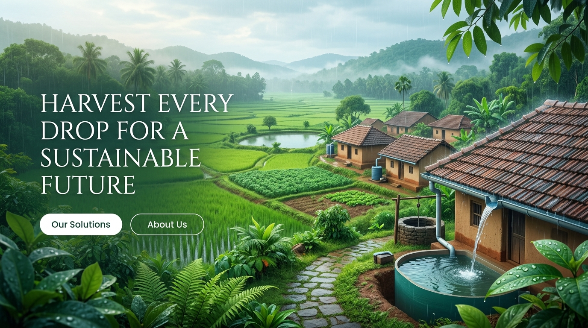

# 💧 RainHarvest India

> **Harvest Every Drop for a Greener Tomorrow**

A stunning, fully responsive informational website about Rainwater Harvesting in India — built with HTML, CSS, and JavaScript.



---

## 🌿 Features

- **Hero Section** — Animated rain effect with parallax background
- **How It Works** — 5-step visual process with flow diagram
- **Benefits** — 8-card benefits grid (economic, environmental, policy)
- **System Types** — Interactive tabbed view of 4 system types with India-specific context
- **Rainwater Calculator** — Estimate annual harvest volume, money saved, and CO₂ impact
- **India Impact Stats** — Animated count-up statistics on India's water crisis
- **Government Schemes** — Jal Shakti Abhiyan, Atal Bhujal Yojana, PMKSY, MGNREGS
- **FAQ Section** — 7 India-specific FAQs with accordion-style toggle
- **Footer** — Links, government resources, newsletter signup

---

## 🎨 Design

- **Theme**: Clean light theme with green/nature-inspired design
- **Typography**: Outfit (sans-serif) + Playfair Display (serif headlines)
- **Colors**: Curated green palette (#22c55e, #14b8a6, #166534)
- **Animations**: Rain effect, scroll fade-in, count-up numbers, floating droplets
- **Responsive**: Mobile-first, fully responsive across all screen sizes

---

## 🧮 Calculator Formula

```
Volume (L) = Rainfall (mm) × Area (m²) × Runoff Coefficient × System Efficiency (0.85) × 1000
```

**Supported cities with pre-filled rainfall data:**
Mumbai • Chennai • Bengaluru • Delhi • Kolkata • Hyderabad • Pune • Ahmedabad • Jaipur • Bhopal

---

## 📁 Project Structure

```
Rainwater Harvesting/
├── index.html       # Main HTML file (all sections)
├── style.css        # Stylesheet (design system + components)
├── script.js        # JavaScript (interactions, calculator, animations)
├── hero-bg.jpg      # Hero background image
└── README.md        # Project documentation
```

---

## 🚀 Getting Started

Simply open `index.html` in any modern browser — no build steps required!

```bash
# Clone the repository
git clone https://github.com/abhijeetpatel6203-web/Rainwater-Harvesting.git

# Open in browser
open index.html
```

---

## 🏛️ Government Resources Referenced

- [Jal Shakti Ministry](https://jalshakti-dowr.gov.in)
- [Central Ground Water Board](https://cgwb.gov.in)
- [Atal Bhujal Yojana](https://ataljal.mowr.gov.in)
- [Ministry of Environment](https://moef.gov.in)

---

## 📊 Data Sources

- India Meteorological Department (IMD) — rainfall data
- Central Ground Water Board (CGWB) — groundwater statistics
- NITI Aayog Water Reports — water stress projections
- Jal Shakti Ministry — scheme details

---

## 🌍 Why Rainwater Harvesting?

India receives over **4,000 BCM** of annual rainfall yet **600 million people** face water stress. Rainwater harvesting is a proven, cost-effective solution to:
- Reduce household water bills (save ₹3,000–₹15,000/year)
- Recharge depleting groundwater
- Prevent urban flooding
- Support rain-fed agriculture

---

*Built with ❤️ for a water-secure India 🇮🇳*
