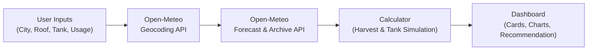

<div align="center">

# 🌧️ RainWise
### Rainwater Harvesting Monitor & Decision-Support System

Rainwater harvesting monitor with live rainfall by location, dynamic tank simulation, savings estimate, and yearly harvest forecast.

[](https://developer.mozilla.org/en-US/docs/Web/HTML)
[](https://developer.mozilla.org/en-US/docs/Web/CSS)
[](https://developer.mozilla.org/en-US/docs/Web/JavaScript)
[](https://www.chartjs.org/)
[](https://abhijeetpatel6203-web.github.io/Rainwater-Harvesting/)

**Live Demo:** [abhijeetpatel6203-web.github.io/Rainwater-Harvesting](https://abhijeetpatel6203-web.github.io/Rainwater-Harvesting/)

</div>

---

## 📑 Contents
- [Abstract](#abstract)
- [Problem Statement](#problem-statement)
- [Objectives](#objectives)
- [Features](#features)
- [System Overview](#system-overview)
- [Tech Stack](#tech-stack)
- [How the Harvest is Calculated](#how-the-harvest-is-calculated)
- [Project Structure](#project-structure)
- [Getting Started](#getting-started)
- [Deployment](#deployment)
- [Limitations](#limitations)
- [Future Scope](#future-scope)
- [Environmental Relevance](#environmental-relevance)
- [References](#references)
- [Academic Details](#academic-details)

---

## Abstract
**RainWise** is a web application that shows how much rainwater a building can collect. A user searches for a city, enters their roof area, roof type, tank size, and daily water use, and the app fetches recent and forecast rainfall for that location. It then works out the litres harvested, how full the tank gets, how many days the stored water lasts, and the money saved on the water bill. The project was built for the Environmental Studies course to show how free weather data and a simple calculator can make rainwater harvesting easier to plan and to justify.

---

## Problem Statement
Many cities rely on groundwater and tanker supply, and water tables keep falling. At the same time, rain that lands on roofs and paved ground runs into drains. That wastes the water and adds to urban flooding. Rainwater harvesting can recharge groundwater and reduce the need for piped water, but most households and campuses cannot tell how much rain their roof would actually collect, what tank size they need, or whether the investment pays off. Without those numbers, few people install a system.

---

## Objectives
- Show how much water a roof can collect from real rainfall at the user's own location.
- Let users enter their own roof area, roof type, tank size, and water use.
- Simulate the tank day by day, including overflow and days without water.
- Estimate the yearly harvest and the savings on the water bill.
- Explain how rainwater harvesting works, which system types exist, and which Indian schemes support it.
- Run entirely in the browser with no account, no backend, and no API key.

---

## Features
- **City Search:** Look up any city and get its coordinates through the Open-Meteo Geocoding API. Default city: **Bengaluru**.
- **Live Rainfall:** Daily rainfall for the past 30 days and the next 7 days, shown in a chart with past and forecast days marked differently.
- **Harvesting Calculator:** Inputs are roof area, roof type, tank capacity, daily household use, first-flush loss, and water tariff.
- **Tank Simulation:** A day-by-day model of the tank level, tracking storage, overflow, and shortfall.
- **Dashboard:** Summary cards for total litres harvested, current tank level, days of supply left, overflow lost, and money saved.
- **Recommendations:** A short message that suggests a larger tank or a recharge pit when overflow is high.
- **Yearly Estimate:** Uses 365 days of rainfall data to estimate annual and monthly harvest.
- **Learning Sections:** Explains how rainwater harvesting works, the main system types (rooftop, surface runoff, groundwater recharge, check dams), national impact figures, government schemes, and an FAQ.
- **Responsive Layout:** Optimized for mobile phones ($\ge 375\text{px}$), tablets, and desktops.

---

## System Overview
The app has no backend of its own. The browser communicates directly with public Open-Meteo APIs:
1. **Input:** The user enters a city, which the Geocoding API converts to latitude and longitude, plus roof area, roof type, tank capacity, and daily water use.
2. **Processing:** The coordinates are sent to the Open-Meteo Forecast and Archive APIs, which return daily rainfall in millimetres. The calculator turns each day's rainfall into litres and simulates the tank day-by-day.
3. **Output:** The page renders the summary metric cards, the rainfall and tank level charts, the yearly estimate, and engineering recommendations.



---

## Tech Stack

| Layer | Technology |
| :--- | :--- |
| **Structure & Styling** | HTML5, Vanilla CSS3 (Custom Design System, Mobile-First) |
| **Logic** | Vanilla JavaScript (ES6+, No Frameworks) |
| **Calculation Engine** | `calculator.js` (Pure mathematical functions) |
| **Charts** | Chart.js (via CDN) |
| **Geocoding** | Open-Meteo Geocoding API |
| **Rainfall Data** | Open-Meteo Forecast API (`precipitation_sum`, past 30 days + 7-day forecast) |
| **Hosting** | GitHub Pages |

---

## How the Harvest is Calculated
One millimetre of rain falling on one square metre of surface gives one litre of water ($1\text{ mm} \times 1\text{ m}^2 = 10^{-3}\text{ m} \times 1\text{ m}^2 = 10^{-3}\text{ m}^3 = 1\text{ L}$).

For each day, the app calculates:
$$\text{harvest (litres)} = \max(0, \text{rainfall\_mm} - \text{first\_flush\_mm}) \times \text{roof\_area\_m}^2 \times \text{runoff\_coefficient}$$

- **First-Flush:** The initial portion of a rain event washes dust and debris off the catchment surface and is diverted away from the tank. The default is $1\text{ mm}$.
- **Runoff Coefficient:** Represents the proportion of rainfall that actually reaches the storage tank, based on roof material:

| Roof Type | Runoff Coefficient |
| :--- | :---: |
| **Concrete / RCC** | `0.85` |
| **Clay / Ceramic Tiles** | `0.80` |
| **Metal / GI Sheet** | `0.90` |

> **Example:** A $100\text{ m}^2$ concrete roof in a $50\text{ mm}$ rain with a $1\text{ mm}$ first flush collects:  
> $$(50 - 1) \times 100 \times 0.85 = 4,165\text{ litres}$$

### Tank Simulation Model
The tank is simulated day-by-day:
- $\text{tank}_{\text{harvest}} = \min(\text{capacity}, \text{tank} + \text{harvest})$
- $\text{overflow} = \max(0, \text{tank} + \text{harvest} - \text{capacity})$
- $\text{tank}_{\text{end}} = \max(0, \text{tank}_{\text{harvest}} - \text{daily\_use})$ *(never below 0)*

**Money Saved:** Litres of stored water used, converted to kilolitres ($\text{kL} = 1,000\text{ L}$) and multiplied by the local water tariff in rupees per kL ($₹/\text{kL}$).

---

## Project Structure

```text
Rainwater-Harvesting/
├── index.html         # Page structure and all sections (Hero, How It Works, Systems, Calculator, Live Monitor, Stats, FAQ)
├── style.css          # Design system, layout, theming, and responsive rules (>= 375px)
├── script.js           # UI interactions, Open-Meteo API integration, Chart.js rendering
├── calculator.js      # Pure functions for daily harvest, tank simulation, and recommendations
├── hero-bg.jpg        # Hero section background asset
└── README.md          # Comprehensive project documentation
```

---

## Getting Started

### Requirements
- Any modern web browser (Chrome, Firefox, Safari, Edge)
- Active internet connection (rainfall and geocoding data are fetched live)
- No API key, installation, or build step required

### Run Locally
```bash
# Clone the repository
git clone https://github.com/abhijeetpatel6203-web/Rainwater-Harvesting.git
cd Rainwater-Harvesting

# Start a local static server
python3 -m http.server 8000
```
Open [http://localhost:8000](http://localhost:8000/) in your browser.

---

## Deployment
The site is hosted automatically using GitHub Pages:
1. Open the repository on GitHub and go to **Settings** $\rightarrow$ **Pages**.
2. Under **Build and deployment**, choose **Deploy from a branch**.
3. Select branch: `main` and folder: `/ (root)`, then click **Save**.
4. The site is published live at:  
   `https://abhijeetpatel6203-web.github.io/Rainwater-Harvesting/`

---

## Limitations
- **Data Source:** Rainfall comes from Open-Meteo, which provides numerical model-based data at grid resolution. Values may differ slightly from a physical rain gauge on a specific rooftop.
- **Forecast Uncertainty:** The next 7 days represent meteorological forecast projections and can change with incoming weather fronts.
- **Simplified Model:** Uses fixed runoff coefficients and first-flush loss. Does not model pipe friction, tank evaporation, or filtration losses.
- **Estimates Only:** Savings depend on municipal or private tanker tariffs entered by the user.
- **Reference Content:** Impact numbers and scheme descriptions are educational summaries.

---

## Future Scope
- Connect low-cost IoT rain gauges and ultrasonic tank level sensors (e.g. ESP32 + HC-SR04).
- Add regional GIS map layers showing rainfall and groundwater depletion across Indian districts.
- Include water quality testing guidelines for potable vs. non-potable domestic use.
- Add an investment payback calculator (capital cost of tanks, piping, filters vs. tanker savings).
- Push alerts when severe rainfall is forecast to prepare rain gutters.

---

## Environmental Relevance
Harvesting rainwater reduces stress on municipal and tanker water supplies, lowers energy consumed in deep groundwater pumping and water transportation, and prevents urban stormwater runoff from overwhelming storm drains. By giving communities concrete calculations on the litres their roofs can capture, RainWise makes sustainable water planning tangible and actionable using open, free environmental data.

---

## References
- Open-Meteo, [Weather Forecast API Documentation](https://open-meteo.com/en/docs)
- Open-Meteo, [Historical Weather API Documentation](https://open-meteo.com/en/docs/historical-weather-api)
- Open-Meteo, [Geocoding API Documentation](https://open-meteo.com/en/docs/geocoding-api)
- Chart.js, [Official Documentation](https://www.chartjs.org/docs/latest/)
- Ministry of Jal Shakti, Government of India, [jalshakti-dowr.gov.in](https://jalshakti-dowr.gov.in/)
- Central Ground Water Board (CGWB), [cgwb.gov.in](http://cgwb.gov.in/)

---

## Academic Details

| Item | Detail |
| :--- | :--- |
| **Project** | **RainWise: Rainwater Harvesting Monitoring & Decision-Support System** |
| **Course** | Environmental Studies (EVS) |
| **Semester** | V, CSE |
| **Institution** | RV Institute of Technology and Management |
| **Author** | Abhijeet Anand ([@abhijeetpatel6203-web](https://github.com/abhijeetpatel6203-web)) |
